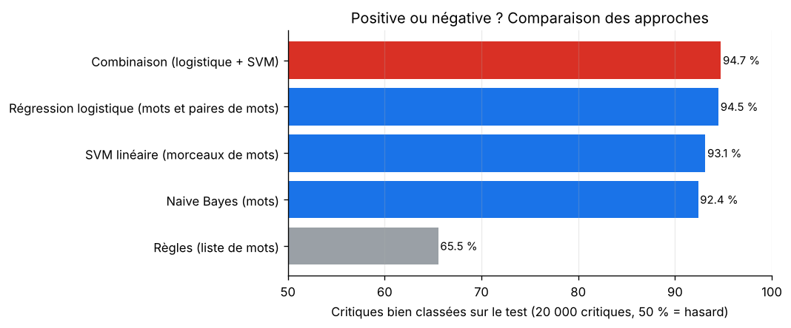
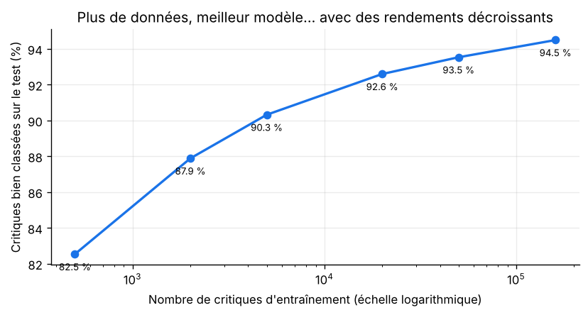
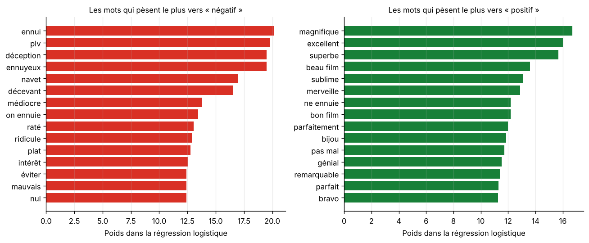
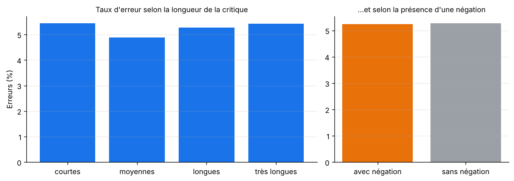

<div align="center">

# 💬 Analyse de sentiments en français

**Une critique de film est-elle positive ou négative ? Cinq approches comparées sur 200 000 critiques Allociné.**

Classification de texte (NLP) · TF-IDF · régression logistique · SVM · analyse des erreurs et des raccourcis du modèle


</div>

---

## 🎯 Le problème

Une entreprise reçoit chaque jour des milliers d'avis : sur ses produits, son service client, ses applications.
Impossible de tout lire. Classer automatiquement chaque avis en **positif** ou **négatif** permet de suivre la satisfaction,
de repérer un problème qui monte, ou de router les mécontents vers le bon service.

Ici, le terrain d'entraînement est un grand classique du français : les **critiques de films** d'internautes.

**Données** : jeu Allociné de Théophile Blard (2020) — **200 000 critiques** en français, moitié positives, moitié négatives,
réparties en entraînement (160 000), validation (20 000) et test (20 000). Une critique fait en médiane 67 mots.
Les critiques **ne sont pas recopiées dans ce dépôt** : elles sont téléchargées depuis le dépôt d'origine à la première exécution.

---

## 🏆 Résultats



| Approche | Validation | **Test** | ROC AUC (test) | Temps d'entraînement |
|---|:-:|:-:|:-:|:-:|
| Règles (liste de 58 mots, gestion de la négation) | 65,2 % | 65,5 % | 0,792 | 1 s |
| Naive Bayes (mots et paires de mots) | 92,3 % | 92,4 % | 0,968 | 2 min |
| SVM linéaire (morceaux de mots de 2 à 5 caractères) | 93,1 % | 93,1 % | 0,982 | 9 min |
| Régression logistique (mots et paires de mots, TF-IDF) | 94,4 % | 94,5 % | 0,988 | 3 min |
| **Combinaison (logistique + SVM)** | **94,7 %** | **94,7 %** | **0,988** | — |

*Pourcentage de critiques bien classées. Les réglages sont choisis sur la validation ; le test n'est utilisé qu'une fois, à la fin.*

**Pour situer ces résultats**, l'auteur du jeu de données publie les siens sur le même découpage :
94,4 % pour sa régression logistique TF-IDF (nous obtenons 94,5 %), et **97,4 % pour CamemBERT**,
un modèle de langue de type Transformer pré-entraîné sur du français. L'écart de 3 points est le prix de la simplicité :
nos modèles s'entraînent en quelques minutes sur un ordinateur portable et s'expliquent mot par mot.

Sur les 20 000 critiques de test, la combinaison se trompe 1 051 fois : 550 critiques négatives classées positives,
501 positives classées négatives. Les erreurs sont équilibrées.

---

## 🔬 La démarche

### 1. Une référence sans apprentissage

Avant tout modèle, une approche « à la main » : +1 par mot positif (*magnifique, excellent…*), −1 par mot négatif (*ennuyeux, navet…*),
avec inversion après une négation (*« pas mauvais »*). Elle plafonne à **65,5 %**. Écrire des règles ne passe pas à l'échelle :
le vocabulaire des critiques est trop riche.

### 2. Transformer le texte en nombres : TF-IDF

Chaque critique devient un vecteur où chaque mot (ou **paire de mots** : *« pas mal »*, *« bon film »*) reçoit un poids
d'autant plus fort qu'il est fréquent dans la critique et rare dans l'ensemble des critiques.
Les paires de mots sont essentielles : *« mal »* est négatif, *« pas mal »* est positif.

Deux façons de découper le texte sont comparées :
- **en mots et paires de mots** (300 000 colonnes) ;
- **en morceaux de 2 à 5 caractères** (400 000 colonnes) : plus robuste aux fautes de frappe et aux variantes
  (*« génial », « géniale », « géniaaal »*), mais moins précis ici.

### 3. Combien de critiques faut-il ?



Avec **500 critiques**, le modèle atteint déjà 82,5 % ; avec 5 000, 90,3 % ; avec les 160 000, 94,5 %.
Chaque multiplication des données par 10 rapporte de moins en moins : c'est l'information qui permet de décider
s'il vaut la peine d'annoter plus de données.

### 4. Ce que le modèle a appris



Le modèle a retrouvé seul le vocabulaire de la critique : *magnifique, excellent, sublime, bijou* d'un côté ;
*ennui, déception, navet, médiocre* de l'autre. Il a aussi appris des **expressions** : *« pas mal »* et
*« ne [s']ennuie »* comptent comme positives, alors que *« mal »* et *« ennuie »* seuls sont négatifs.

### 5. Un raccourci inattendu : « plv »

Parmi les mots les plus négatifs figure **« plv »**, qui n'est pas un mot du dictionnaire. Il apparaît dans 258 critiques
d'entraînement, chacune sur un film différent, et **98 % d'entre elles sont négatives** : c'est très probablement
la signature d'un même internaute, plutôt sévère.

Le modèle a donc appris en partie **qui écrit**, et pas seulement **ce qui est écrit**. Ici l'effet est mineur,
mais c'est exactement le genre de **raccourci** (*shortcut learning*) qui fait échouer un modèle en production :
sur les avis d'une autre plateforme, ce signal n'existe plus. Lire les poids du modèle permet de le détecter.

### 6. Où le modèle se trompe



- Le taux d'erreur est **stable quelle que soit la longueur** de la critique (entre 4,9 % et 5,4 %).
- Les critiques contenant une **négation** (*pas, jamais, rien…*) ne sont **pas** plus souvent mal classées
  (5,2 % contre 5,3 %) : les paires de mots capturent bien les négations simples.

Les vraies difficultés apparaissent sur des phrases plus subtiles. Huit phrases ont été écrites pour ce projet
(elles ne viennent pas du jeu de données) :

| Phrase | Attendu | Règles | Logistique | SVM |
|---|:-:|:-:|:-:|:-:|
| Un film magnifique, des acteurs justes et une fin qui m'a ému. | 👍 | ✅ | ✅ | ✅ |
| Deux heures d'ennui, un scénario creux et des dialogues ridicules. | 👎 | ✅ | ✅ | ✅ |
| Pas mauvais du tout, je ne m'attendais pas à passer un si bon moment. | 👍 | ✅ | ✅ | ❌ |
| Je ne recommande pas : rien n'est réussi, ni l'histoire ni la mise en scène. | 👎 | ✅ | ✅ | ✅ |
| Bravo aux scénaristes, il fallait oser faire aussi plat pendant deux heures. *(ironie)* | 👎 | ❌ | ✅ | ✅ |
| Le début est lent mais la seconde moitié est vraiment excellente. | 👍 | ✅ | ❌ | ✅ |
| Les effets spéciaux sont superbes, dommage que l'histoire ne suive pas. | 👎 | ✅ | ✅ | ❌ |
| Rien d'original, mais ça se regarde avec plaisir en famille. | 👍 | ✅ | ❌ | ❌ |

Les phrases **à deux temps** (*« X, mais Y »*), où c'est la seconde partie qui compte, mettent les modèles en difficulté :
ils additionnent les mots sans comprendre lequel l'emporte. C'est précisément ce que les modèles de type Transformer
(CamemBERT) savent mieux faire, grâce au contexte. Huit phrases ne font pas une statistique : ce tableau illustre des cas typiques,
il ne mesure pas une performance.

---

## 🚀 Lancer le projet

**Windows, en un double-clic** : `lancer.bat` installe tout, télécharge les critiques (≈ 65 Mo, une seule fois),
entraîne les modèles (environ 15 minutes) et ouvre les graphiques.

**À la main :**
```bash
python -m venv .venv
# Windows : .venv\Scripts\activate     macOS / Linux : source .venv/bin/activate
pip install -r requirements.txt
cd src && python -m sentiment.train && cd ..
pytest -v      # 4 tests
```

**Utiliser le modèle entraîné :**
```python
import joblib
model = joblib.load("models/model.joblib")["modele"]
model.predict(["Une mise en scène inventive et des acteurs formidables."])   # -> [1] : positif
```

---

## 🗂️ Organisation du code

```
sentiment-allocine/
├── data/                     Critiques téléchargées à la première exécution (ignoré par Git)
├── src/sentiment/
│   ├── data.py               Téléchargement et chargement des critiques
│   └── train.py              5 approches, courbe d'apprentissage, mots importants, analyse des erreurs
├── models/model.joblib       Régression logistique entraînée (rapide et explicable)
├── reports/                  metrics.json et figures
├── tests/test_sentiment.py   4 tests (règles et négation, données hors du dépôt…)
└── lancer.bat
```

---

## 🧭 Limites et pistes

- **Le contexte** : les modèles « sac de mots » ne comprennent pas les phrases à deux temps ni l'ironie.
  Affiner **CamemBERT** sur ces critiques gagnerait environ 3 points, au prix d'un GPU et d'un modèle bien plus lourd.
- **Le domaine** : un modèle entraîné sur des films se transfère mal à d'autres avis (« la batterie tient longtemps » est
  positif, « le film est long » ne l'est pas). Il faudrait quelques milliers d'avis annotés du nouveau domaine.
- **Deux classes seulement** : les avis réels sont souvent nuancés ; une note de 1 à 5 (régression ou classification ordinale)
  serait plus fidèle.

---

## 👤 Auteur

**Elie Samson Kombiwo** — Data Scientist (MLOps / LLMOps)
[GitHub](https://github.com/gitsam1path) · [LinkedIn](https://www.linkedin.com/in/elie-samson-kombiwo-4075a4284)

<sub>Données : T. Blard, *French sentiment analysis with BERT* (2020), jeu de critiques Allociné —
[dépôt d'origine](https://github.com/TheophileBlard/french-sentiment-analysis-with-bert). Les critiques restent la propriété
de leurs auteurs et ne sont pas redistribuées ici.</sub>
